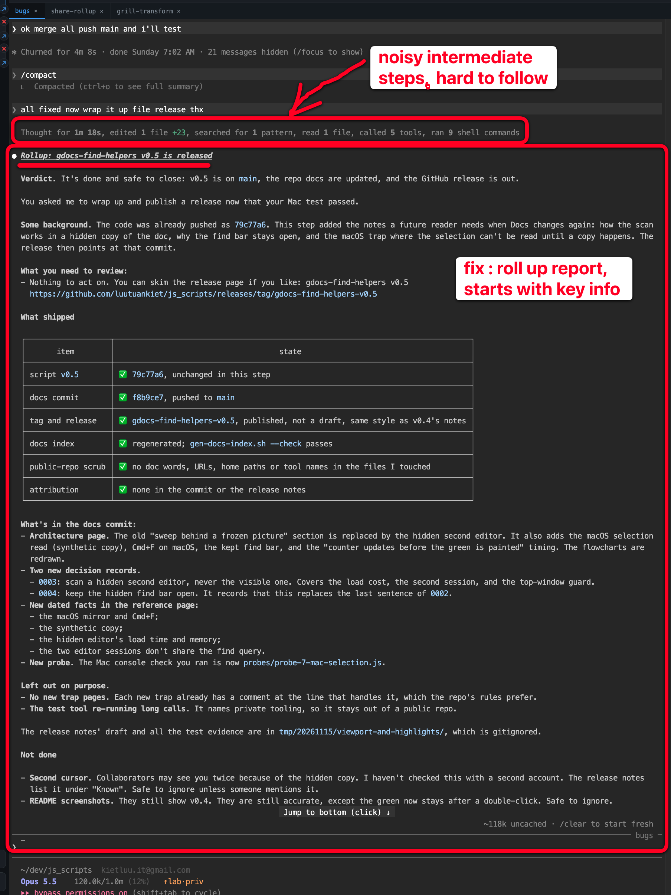
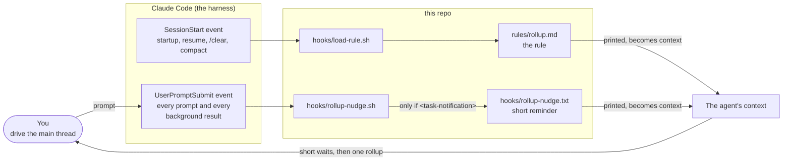

# sample-claude-rollup-setup

**You drive the main thread. The harness and the agent do the plumbing.**

A small, self-contained Claude Code setup for engineers who hand real work to
an agent. The agent can run tool calls, subagents and background jobs for
twenty minutes; you read one reply at the end, the **rollup**, and it has
everything: the verdict first, your original ask in your own words, the
evidence, every open question in full, and what is not done.



## Why

Your attention is limited; the agent's output is not.

You ask for one thing. The agent starts two subagents and a long background
job. For the next twenty minutes the screen fills with tool calls, file reads,
half-findings and status lines. You try to follow along, because it looks
important. Then the last result lands and you realise you no longer remember
what you asked for, which options were on the table, or what is waiting on you.
The thread you were driving got lost in the noise.

The usual fix is discipline: tell the agent, again, to summarise properly at
the end. That works until the session gets long and the instruction fades.
This setup makes it plumbing instead:

- **The harness** (Claude Code) loads the rule into every session and taps the
  agent on the shoulder at the exact moment it tends to forget it, so you never
  have to repeat yourself.
- **The agent** stays quiet while work runs, then folds everything into one
  final reply written for someone who saw none of it.
- **You** read the last reply, decide, and keep driving. The intermediate noise
  is still in scrollback if you want it, but you never need it.

## New to Claude Code? Three terms

| term | what it is | why it matters here |
|---|---|---|
| **hook** | a shell command Claude Code runs on an event (session start, each prompt, each tool call). Whatever it prints to stdout is added to the agent's context. | how the rule gets in, and how the reminder arrives, without you typing anything |
| **subagent** | a helper agent the main agent starts for a side task. It works in its own context and reports back once. | the main source of long, noisy stretches you are tempted to follow |
| **background task** | a subagent or shell command left running while the conversation continues. When it finishes, Claude Code wakes the agent with a `<task-notification>` message. | that wake-up is the moment the nudge fires |

Hooks are the advanced part, and the part that pays off: they move "remember
to do X" from your head into the harness.

## How it fits together

Three small files and one rule. The harness calls the scripts; the scripts
print text; the text lands in the agent's context.



The walkthrough below is the demo session further down, step by step. Notice
how little of it is addressed to you.

```mermaid
sequenceDiagram
  actor U as You
  participant H as Claude Code
  participant A as Agent
  participant S1 as Subagent: logs
  participant S2 as Subagent: test copy
  H->>A: SessionStart: load-rule.sh prints the rule
  U->>H: "nightly export got slow, find out why and fix it"
  H->>A: prompt (nudge silent: no task-notification)
  A->>S1: read export logs + recent migrations (background)
  A->>S2: build a data copy, time the export (background)
  A-->>U: "Two helpers running; back when both report." (1 line)
  Note over A,S2: ~20 minutes of tool calls,<br/>reads and status lines you do not need
  S1-->>H: done
  H->>A: task-notification + ROLLUP CHECK nudge
  A-->>U: "Logs helper done, waiting on the test copy." (1 line)
  S2-->>H: done
  H->>A: task-notification + ROLLUP CHECK nudge
  A-->>U: # Rollup: verdict, threads, open questions, what is blocked on you
  U->>H: "yes"
```

The full map, with a flow for compaction and the mistakes that are easy to
make, is in [docs/how-it-works.md](docs/how-it-works.md).

## Demo: twenty minutes of noise, one reply to read

A made-up session. You asked one thing, the agent went off for twenty minutes,
and the screen filled up. This is roughly what scrolled past while you were
trying to follow:

```text
> nightly export got slow last week. find out why and fix it

  ● Agent(logs helper: read export logs + last 2 weeks of migrations)
      background · running
  ● Agent(test-copy helper: restore last night's data, time the export)
      background · running
  First guess: the database has outgrown its instance. Two helpers
  running to check; I'll be back when both report.

  [00:02] ⎿ Read logs/export/2026-11-0*.log (14 files)
  [00:03] ⎿ Grep "join_orders" → 212 matches
  [00:04] ⎿ Bash pg_restore --jobs 4 nightly.dump  ... running
  [00:05] ⎿ Read migrations/0039_rebuild_orders.sql
  [00:06] ⎿ Read migrations/0040_add_region.sql
  [00:07] ⎿ Grep "CREATE INDEX" migrations/ → 31 matches
  [00:08] ⎿ Bash psql -c "\d orders"
  [00:09] ⎿ Read config/export.yml
  ...     (43 more tool calls)
  [00:11] logs helper finished
  Logs helper done, waiting on the test copy.
  [00:12] ⎿ Bash pg_restore ... done (11m 02s)
  [00:13] ⎿ Bash time ./export.sh --target copy  ... running
  [00:16] ⎿ Bash psql -c "EXPLAIN ANALYZE ..."  (180 lines)
  [00:18] ⎿ Bash psql -f migrations/0042_orders_customer_idx.sql
  [00:19] ⎿ Bash time ./export.sh --target copy  ... 5m 50s
  ...     (27 more tool calls)
  [00:21] test-copy helper finished
```

By minute ten most people have stopped reading and are guessing. By minute
twenty, "what did I ask for, and what do I need to decide?" is a real question.
Without the setup, the agent's last message is usually about the last thing it
touched ("the export ran in 5m50s on the copy"), and you scroll up to rebuild
the rest yourself.

With the setup, the last reply is this:

---

> # Rollup: nightly export is slow because of one unindexed join
>
> **Verdict.** Add the index on `orders.customer_id`; it takes the export from
> 41 minutes to about 6, and nothing else needs to change.
>
> You asked why the nightly export started taking over 40 minutes last week.
>
> **Some background.** The export joins every order to its customer. Last
> Tuesday's migration rebuilt the `orders` table and dropped its index on
> `customer_id`, so each join now scans the whole table. Last night's
> production run took 41 minutes. On a restored copy of the same data, on the
> same size of machine, adding the index brought the export down to 5 minutes
> 50 seconds. That is why the index is the fix and not a bigger machine.
>
> **Changes you should know:**
>
> A bigger database instance is no longer the answer. It was my first guess,
> but the test copy ran on the same size of machine and got fast with the
> index alone. If you already asked anyone about a larger instance, you can
> call it off.
> ↳ the line "First guess", in my first reply right after your message
> "nightly export got slow last week. find out why and fix it"
>
> **What you need to review:**
> - The one-line migration in `migrations/0042_orders_customer_idx.sql`.
>
> **Where we are.** The goal was to find and fix the slowdown. The cause is
> found and proven on a copy; the fix is written but not applied to
> production, because that needs your go-ahead.
>
> ---
>
> ## Thread 1: why the export is slow
>
> **Verdict.** Done, safe to close: the missing index is the whole cause.
>
> **How we know**
> 1. The export log shows the join step went from 3 to 38 minutes on the night
>    of the migration.
> 2. The migration file rebuilds `orders` without re-creating its indexes.
> 3. On a restored copy of the data, adding the index brought the export back
>    to 5m50s.
>
> `Not done:` nothing.
>
> ---
>
> ## Thread 2: applying the fix
>
> **Verdict.** Apply the index tonight before the export runs.
>
> You asked for the fix, not just the cause.
>
> **Some background.** Building the index takes about 2 minutes and locks
> nothing, because the migration uses the database's online index build.
>
> **Should I apply the migration to production tonight at 21:00, before the
> export at 23:00?**
> - **A: tonight.** The export is fast from tonight. Cost: a 2 minute build on
>   production; if it fails, the export simply stays slow one more night.
> - **B: wait for Monday's release.** No out-of-band change. Cost: four more
>   nights of 40 minute exports, and the morning report stays late.
>
> My read: A. "Yes" applies it tonight at 21:00.
>
> `Not done:`
> - Production migration: blocks the fast export, waiting on you.
> - The dashboards that read the export are untested with the new timing: safe
>   to ignore, they only read the finished file.
>
> ---
>
> | decision | my read |
> |---|---|
> | apply the index tonight | yes, at 21:00 |
>
> Blocked on you: the go-ahead for tonight's migration.

---

What to notice, mapped to the twenty minutes above:

| in the rollup | what it saves you |
|---|---|
| the verdict is the first sentence | you can stop reading after one line |
| "You asked ..." restates your prompt | the main thread is back in front of you, word for word |
| "Changes you should know" | the early guess you may have acted on is retracted out loud, with a `↳` pointer to where it was said |
| the question is restated whole, with costs | you answer "yes" without scrolling up |
| `Not done:` and "Blocked on you" | nothing finished reads as forgotten, nothing pending reads as finished |
| no tool calls, no dead ends | the 70-odd intermediate steps stay in scrollback, where they belong |


## Install

Pick **one** of these. Mixing two makes the hooks fire twice.

### A. As a plugin (one command, recommended)

```sh
claude plugin marketplace add luutuankiet/sample-claude-rollup-setup
claude plugin install rollup@sample-claude-rollup-setup
```

Start a new session. Both hooks are live for every project. Update later with
`claude plugin update rollup@sample-claude-rollup-setup`.

### B. Manual hooks in your settings

Clone the repo somewhere stable:

```sh
git clone https://github.com/luutuankiet/sample-claude-rollup-setup ~/.claude/rollup-setup
```

Then merge this into `~/.claude/settings.json` (all projects) or a project's
`.claude/settings.json` (that project only):

```json
{
  "hooks": {
    "SessionStart": [
      { "hooks": [ { "type": "command", "command": "bash \"$HOME/.claude/rollup-setup/hooks/load-rule.sh\"", "timeout": 5 } ] }
    ],
    "UserPromptSubmit": [
      { "hooks": [ { "type": "command", "command": "bash \"$HOME/.claude/rollup-setup/hooks/rollup-nudge.sh\"", "timeout": 5 } ] }
    ]
  }
}
```

### C. Rule in `CLAUDE.md`, nudge only as a hook

If you would rather keep the rule in memory, where you can see and edit it, add
this line to `~/.claude/CLAUDE.md` (or a project's `CLAUDE.md`):

```md
@~/.claude/rollup-setup/rules/rollup.md
```

and bind only the `UserPromptSubmit` hook from option B. Claude Code reloads
`CLAUDE.md` after a compaction, so you do not need the `SessionStart` hook.

### D. Let your agent do it

Open Claude Code anywhere and say:

> Read https://github.com/luutuankiet/sample-claude-rollup-setup/blob/main/AGENTS.md and install this setup for me.

`AGENTS.md` walks the agent through choosing an option, installing it and
checking it works.

### Check it works

Run `/hooks` in a new session: you should see `SessionStart` and
`UserPromptSubmit` entries pointing at this repo's scripts. Then ask the agent
to run something in the background (for example "run `sleep 20` in the
background, then tell me when it is done"). When it finishes you should get a
reply opening with `# Rollup:` and a `**Verdict.**` line.


## Repo layout

```
.claude-plugin/   plugin.json + marketplace.json (option A)
hooks/            hooks.json, load-rule.sh, rollup-nudge.sh, rollup-nudge.txt
rules/rollup.md   the rule the agent follows
docs/             how-it-works.md, the component map and flows
AGENTS.md         onboarding for an agent installing or changing this setup
```

The demo screenshot lives on the `assets` branch so `main` stays small.

## License

MIT
