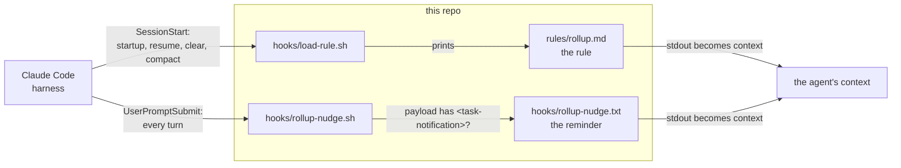
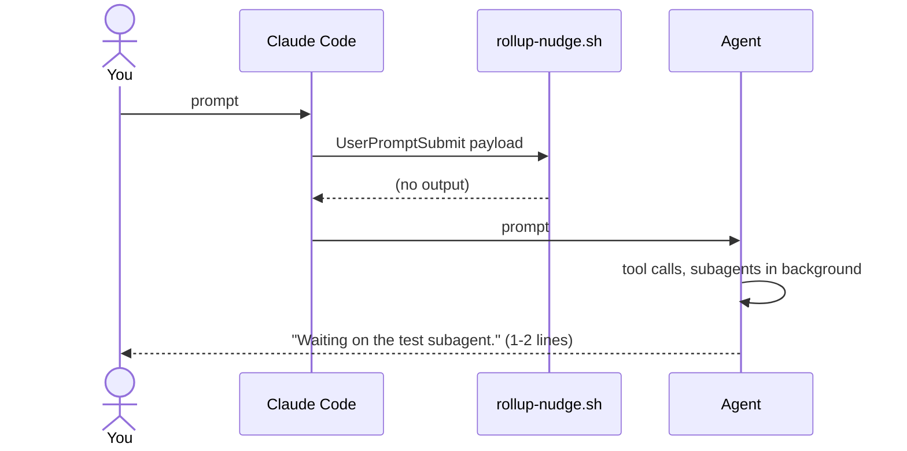
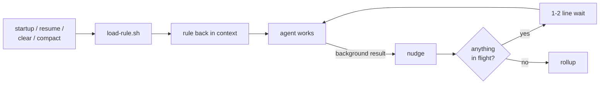

# How it works

This page maps every file in the setup to its job, then walks through the two
moments that matter: an ordinary turn, and a background result landing.

## The problem it is built for

Your attention is the scarce resource in an agent session, not the agent's.
You set the scope at the start, then the agent works: tool calls, file reads,
subagents, background shells. You half-follow that stream while doing other
things. By the time the agent stops, the useful facts are scattered across a
dozen intermediate replies, and you have to stitch them back together before
you can decide anything.

This setup moves the stitching to the agent. Intermediate replies stay short.
The last reply of a stretch, the **rollup**, restates the whole session for a
reader who saw none of it: the verdict first, the original ask in your own
words, the evidence, every open question in full, and what is not done. You
stay on the main thread; the noise stays in scrollback.

## First principles

1. **The user reads only the last reply.** Everything else is optional
   scrollback. So the last reply must stand alone.
2. **Key information comes first.** The verdict block answers before it
   explains, so a reader can stop after one sentence.
3. **Quiet while waiting.** While something is still running, a reply is 1-2
   lines: what we wait on. Findings wait for the rollup.
4. **Restate, never point.** A question asked three replies ago is restated in
   full, with its options and costs. An anchor (`↳`) only says where it came
   from.
5. **The rule must survive the session.** Instructions loaded once fade as the
   context grows, and compaction can drop them. So the rule is reloaded at every
   session start and compaction, and re-pressed at the exact moment it is most
   often forgotten: when a background result arrives.

## The pieces

| file | what it is | who reads it | when |
|---|---|---|---|
| `rules/rollup.md` | the rule itself: anchors, quiet-while-waiting, the rollup shape | the agent | every session start, resume, `/clear`, compaction |
| `hooks/load-rule.sh` | prints `rules/rollup.md` | Claude Code, on `SessionStart` | same as above |
| `hooks/rollup-nudge.sh` | prints the nudge, only when a background result arrives | Claude Code, on `UserPromptSubmit` | every turn; silent on all but background results |
| `hooks/rollup-nudge.txt` | the short reminder, plus the shortcuts that fail it | the agent | beside each background result |
| `hooks/hooks.json` | binds both scripts to their events | Claude Code | plugin install only |
| `.claude-plugin/` | plugin and marketplace manifests | `claude plugin` | install time |



Both hooks rely on one Claude Code behaviour: plain stdout from a
`SessionStart` or `UserPromptSubmit` hook is added to the model's context. No
JSON, no `jq`. Both exit 0 on every error, so a broken install can never block
a prompt or a session; it just goes quiet.

## Flow 1: an ordinary turn

You type a prompt. The nudge hook reads the payload, finds no
`<task-notification>` tag, and prints nothing. The rule loaded at session start
is still in context and does its job alone.



## Flow 2: a background result lands

This is the moment the setup exists for. A subagent or background shell
finishes. Claude Code wakes the agent with a turn that carries the result,
tagged `<task-notification>`. Left alone, an agent tends to reply about that one
result and stop, leaving you with yet another fragment. The nudge lands beside
the result and asks one question: is anything else still running?

```mermaid
sequenceDiagram
  participant BG as Background task
  participant CC as Claude Code
  participant N as rollup-nudge.sh
  participant A as Agent
  actor U as You
  BG-->>CC: finished, result ready
  CC->>N: UserPromptSubmit payload with <task-notification>
  N-->>CC: ROLLUP CHECK text
  CC->>A: result + ROLLUP CHECK
  alt something else still running
    A-->>U: "Test subagent done; waiting on the build." (1-2 lines)
  else nothing running
    A-->>U: # Rollup: verdict, threads, open questions, Not done
  end
```

## Flow 3: the session is rebuilt

A long session gets compacted, or you `/clear`, or you resume tomorrow. The
`SessionStart` hook fires on each of these and prints the rule again, so the
rule is never lost with the old context. The rule itself adds one guard: after
a compaction, rebuild the rollup from the transcript, never from the summary,
because a summary has already thrown away the details a cold reader needs.



## What the rollup looks like

Read top to bottom, each layer is enough on its own:

| depth | what you get |
|---|---|
| title only | `# Rollup: <topic>`, the outcome in a few words |
| verdict line | the result and what to do |
| verdict block | your ask in your words, why, what changed, what to review |
| threads | per-topic evidence, diagrams, every open question restated |
| closing table | a "decision / my read" table, then what is blocked on you |

A full example is in the README.

## Things that are easy to get wrong

- **Installing twice.** A plugin hook merges with a `settings.json` hook of the
  same event; it does not replace it. Install either the plugin or the manual
  hooks, not both, or every event fires twice with no error.
- **Rule in `CLAUDE.md` and the plugin.** Same problem for the rule: it lands in
  context twice. Harmless but wasteful.
- **Editing the nudge to carry the whole rule.** The nudge fires on every
  background result; keep it short and let `rules/rollup.md` hold the detail.
